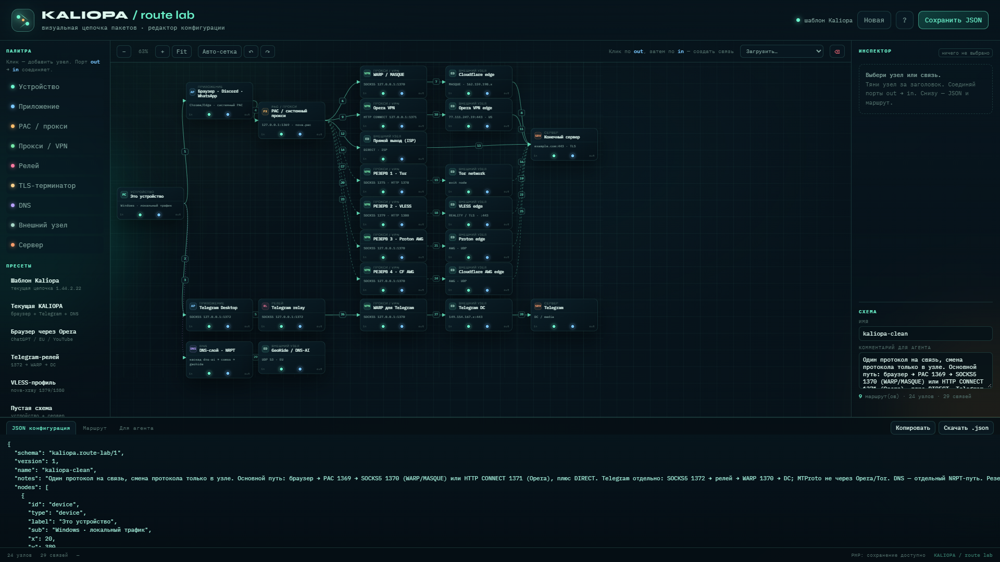

# KALIOPA


**KALIOPA** — приватный форк [Nova](https://github.com/confeden/Nova) для личного
использования: обход DPI, раздельная маршрутизация, Telegram-релей и несколько
независимых VPN-слотов. Название означает - в древнегреческой мифологии старшая и
наиболее уважаемая из девяти олимпийских муз, покровительница эпической поэзии,
науки и философии.

Отображаемое имя — **KALIOPA**; exe, папка установки, мьютекс и AppData остаются
`Nova`, чтобы обновления, хелперы и существующая установка продолжали работать.


## Возможности

- **ChatGPT / Gemini / YouTube** через Opera VPN (рекомендуется EU; US-выход
  OpenAI может отдавать 403).
- **Telegram** через отдельный SOCKS5-релей `127.0.0.1:1372` → WARP → DC;
  MTProto не идёт через Opera/Tor HTTP.
- **PAC-маршрутизация**: браузер получает PAC на `127.0.0.1:1369`, выбирает
  `SOCKS5 1370` (WARP/MASQUE/Proton AWG/CF AWG/Xray), `HTTP 1371` (Opera) или
  `DIRECT`; `.ru` и exclude — напрямую.
- **Резервы по слотам**: Tor `1375/1378`, Xray-профиль `1379/1380`; в каждом
  слоте одновременно живёт только один backend.
- **DNS/NRPT** отдельным путём: AI-домены через каскад dns-ai → comss →
  geohide; DoH — опционально (`NOVA_DOH_GLOBAL=1`).
- **Профили и подписки**: Proton AWG (до 3 вариантов на узел), Xray-подписки
  (VLESS/VMess/Trojan/SS, raw и JSON 3x-ui), WARP/CF AWG, импорт своих конфигов.
- **Метаданные подписок**: остаток трафика, срок действия, название и интервал
  из `Subscription-Userinfo`/`Profile-*` (включая `base64:` заголовки).
- **Стабильность**: backoff Opera, карантин мёртвых Xray-узлов, TCP-гейт
  endpoint'ов, уборка осиротевших процессов.

## Установка

- Windows 10/11 x64.
- Скачать установщик из **[Releases](https://github.com/abonent0007/KALIOPA/releases)**.
- Установщик без подписи; SmartScreen может предупредить.
- Для WinDivert/WFP приложение само запросит права администратора.
- Поверх существующей Nova ставится как обновление; профили и `temp/` не удаляются.

Актуальный релиз: **[v1.44.2.30](https://github.com/abonent0007/KALIOPA/releases/tag/v1.44.2.30)**.

## Донаты на дальнейшее развитие принимаются по ссылке ниже:
**[Ваша помощь в развитии это вклад в свободный интернет для всех.](https://www.sberbank.ru/ru/choise_bank?requisiteNumber=79684520007&bankCode=100000000111)**

## Как идёт трафик

```
Браузер → WinINET → PAC 1369 → SOCKS5 1370 / HTTP 1371 / DIRECT
                                      │              │
                                WARP/MASQUE      Opera VPN
                                      │              │
                               Cloudflare edge   Opera edge → сайт

Telegram Desktop → SOCKS5 1372 → relay → WARP 1370 → Telegram DC

DNS → NRPT (AI-домены) → dns-ai / comss / geohide
```

Полная схема, таблица правил PAC, порты и резервы — в
[`docs/agents/routing.md`](docs/agents/routing.md).

## Отличия от upstream Nova

| Область | Upstream | KALIOPA |
|---|---|---|
| Имя | Nova | KALIOPA (exe/папки — Nova) |
| ChatGPT/Gemini | зависит от выхода | Opera-слот + PAC `ai_apps=opera` |
| Opera | published endpoints первыми | discover + fastest, TCP-гейт relay, кэш рабочего edge |
| Релей | логин из `CURRENT_VERSION` | версия подбирается под ключ |
| Протоколы | VLESS | VLESS + VMess/Trojan/SS, JSON 3x-ui |
| Подписки | интервал локальный | + трафик/срок/название из заголовков |
| PAC | базовые правила | policy-check, Tor-fallback только в «Авто» |
| Окно | 360×270 | размер фона 967×540, UI scale |
| Автообновление | включено | отключено; только списки и профили |
| Установка | Inno Setup | + overlay-скрипт для locked-файлов |

## Route Lab

Двойной клик по **`start-route-lab.bat`** — сервер запускается на
`http://127.0.0.1:8099/`, остановка — **Ctrl+C** в этом окне. Если окно потерялось,
используй `stop-route-lab.bat`.

При первом запуске без PHP скрипт скачает официальный portable PHP 8.4 в
`%LOCALAPPDATA%\KaliopaRouteLab\php`. Вручную: `tools\route-editor\setup-php.bat`.

Открыть `http://127.0.0.1:8099/`. При старте загружается шаблон **Kaliopa**
(`tools/route-editor/templates/kaliopa-clean.json`, 24 узла / 29 связей).
Можно менять узлы, транспорт, условия и порядок, а внизу получить JSON и готовый
промпт для агента.



## Сборка из исходников

Нужны Python 3.14, Go 1.27, Rust 1.90+, Inno Setup 6 и sibling-репозиторий
`Nova Android` (для `replace` в Go-модулях).

```powershell
python tools\bump_fork_version.py
$env:NOVA_SKIP_NOVA_GO='1'; $env:NOVA_SKIP_NOVA_XRAY='1'
$env:NOVA_SKIP_NOVA_ENGINE='1'; $env:NOVA_SKIP_TLS_TERMINATOR='1'
$env:NOVA_SKIP_LIST_SYNC='1'; $env:NOVA_KEEP_STAGING='1'
& "$env:LOCALAPPDATA\Programs\Python\Python314\python.exe" Inno.py
powershell -ExecutionPolicy Bypass -File tools\install_overlay.ps1 -Version <ver>
```

Проверки:

```powershell
python -m unittest discover -s tests -p "test_*.py"
python tools\static_analysis.py
python tools\import_scan.py
python tools\route_policy_check.py
```

## Безопасность

Репозиторий и релизы **приватные**. В git не попадают `profiles/`,
`profiles/opera_relay.key`, `tgrelay/cf_ws.key`, `bin/`, `temp/`, сборки и
`.opencode/`. Установщик содержит штатный relay-ключ и общие WARP-сиды, как
upstream; не переключай репозиторий в публичный.

## Лицензия и благодарности

Проект основан на [Nova](https://github.com/confeden/Nova); лицензия и
сторонние компоненты — в [`LICENSE`](LICENSE) и
[`THIRD_PARTY_NOTICES.md`](THIRD_PARTY_NOTICES.md).
